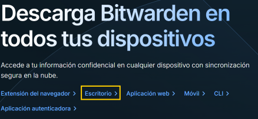
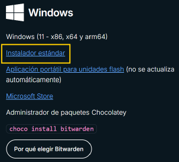
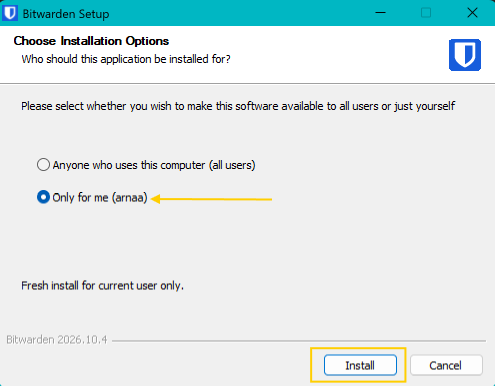
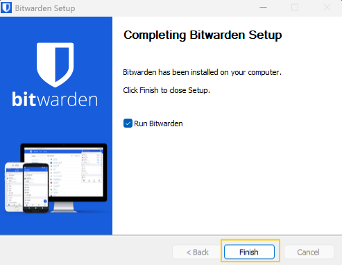
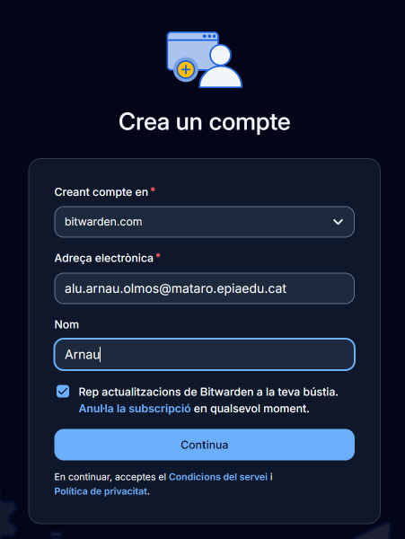
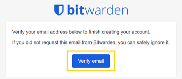
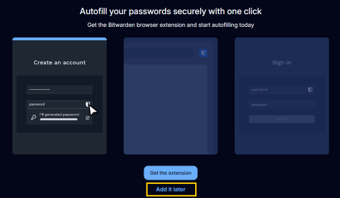
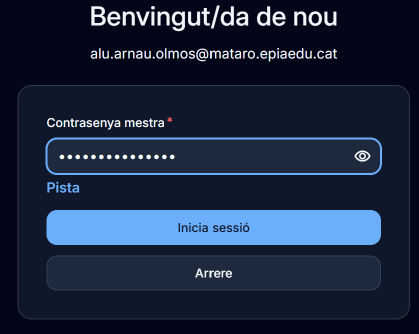

# Guia d'Ús Tècnica

## 1.Instal·lació i Configuració Inicial: Descàrrega, instal·lació i creació de la BBDD principal o compte mestre.

### Descàrregar | Instal·lació

Primer al nostre navegador de confiança busquem `Bitwarden`, i cliquem la primera opcio que ens apareix.

Anem a l'apartat de descargues.

Seleccionem l'opcio de escritori.

I triem l'opcio d'isntaldaor estandar, es la millor opcio sino volem tenir problemes amb les actualitzacions i versions.

Ens sortirar un `.exe` que es l'instalador, l'executem.

Ens apareix una finestra, aqui tenim dos opcions, depenen del que volem marquem una o altre, si volem que tots els usuaris del sipositiu tinguin l'opcio d'usar Bitwarden, marquem la primera opcio, si nomes volem usarlo nosaltres marquem la segona opcio.

Triem quina de les dos volem i despres instalem.

Quan acaba l'instal·ació li donem a "Finish"

Ens surt una finestra per iniciar sessió, en el nostre cas com no tenim compte encara seleccionem "Crear un compte".

Aqui deixem la primera opcio com surt, la de `bitwarden.com`. Posem un correu electronic i si volem podem posar el nom.

Ens  avisen que an enviat un correu de confirmacio per a crear el compte.

Anem al correu, i verifiquem.

Despres de verfificar ens sortira aquesta finsetra, hem de crear una contrasenya segura, que hem de ser capaços de recordarla o tenir acces a ella. Podem afegir una pista per si no ens enrecordem el proxim cop que iniciem sessió.

Ens apareix aquesta finsetra, de moment li donem a "Add later".

Ara nem a comprovar que hem fet be tots els pasos anterirors i provem d'inicar sessió.

Aqui ja estem dintre.

