# Guia d'Ús Tècnica

## 1.Instal·lació i Configuració Inicial: Descàrrega, instal·lació i creació de la BBDD principal o compte mestre.

### Descàrregar | Instal·lació

Primer al nostre navegador de confiança busquem `Bitwarden`, i cliquem la primera opcio que ens apareix.

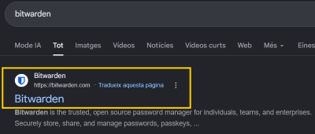

Anem a l'apartat de descargues.

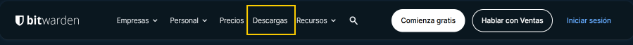

Seleccionem l'opcio de escritori.

I triem l'opcio d'isntaldaor estandar, es la millor opcio sino volem tenir problemes amb les actualitzacions i versions.

Ens sortirar un `.exe` que es l'instalador, l'executem.

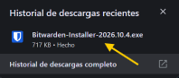

Ens apareix una finestra, aqui tenim dos opcions, depenen del que volem marquem una o altre, si volem que tots els usuaris del sipositiu tinguin l'opcio d'usar Bitwarden, marquem la primera opcio, si nomes volem usarlo nosaltres marquem la segona opcio.

Triem quina de les dos volem i despres instalem.

Quan acaba l'instal·ació li donem a "Finish"

Ens surt una finestra per iniciar sessió, en el nostre cas com no tenim compte encara seleccionem "Crear un compte".

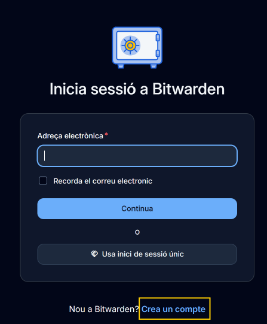

Aqui deixem la primera opcio com surt, la de `bitwarden.com`. Posem un correu electronic i si volem podem posar el nom.

Ens  avisen que an enviat un correu de confirmacio per a crear el compte.

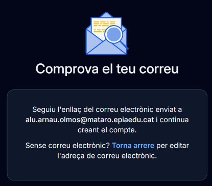

Anem al correu, i verifiquem.

Despres de verfificar ens sortira aquesta finsetra, hem de crear una contrasenya segura, que hem de ser capaços de recordarla o tenir acces a ella. Podem afegir una pista per si no ens enrecordem el proxim cop que iniciem sessió.

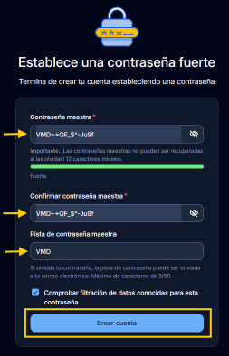

Ens apareix aquesta finsetra, de moment li donem a "Add later".

Ara nem a comprovar que hem fet be tots els pasos anterirors i provem d'inicar sessió.

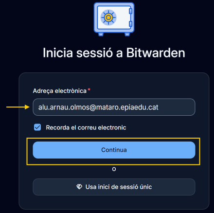

Aqui ja estem dintre.

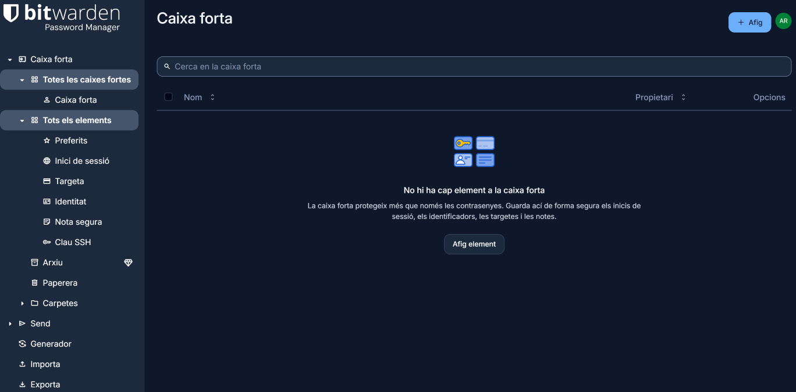

## 2.Generació de Contrasenyes Segures

Un cop hem instalt i creat el compte, podem començar a utilitzar l'eina. Una de les grans opcions que te Bitwarde, es la creacio de contrasenyes segures.

Si anem al menu desplegable que tenim a l'esquerra, trobem l'apartat "Generador"

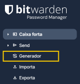

Si entrem tenim diferents opcions de generadors,`Contrasenya`,`Frase de pas` i `Nom d'usuari`. Nosltres ens quem amb la de `Contrasenya`

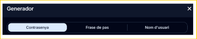

Aqui ja podem demanarli una contrasenya segur.

Tenim diferents opcions per a la contraenya, podem dir quina longitud volem(com mes llarga sugui, mes segura), quin tipus de caracter volem que faci servir, el numero de caracters minims, tant normals com especials i tambe li podem que eviti caracters ambigus.

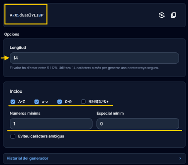

## 3.Exemples d'Ús i Emplenament Automàtic

El que hem vist al punt anterior esta molt be, pero amb el punt anterior, podem perder la contrasenya o oblidarla, per tant no es molt eficient, es per aixo que bitwarden incorpora diferents serveis, per guardar aquesta inforamció.

### 3.1.Com desar una credencial d'un compte de correu electrònic

Una de les coses que podem fer es guardar la contrasenya d'un correu electrònic.

Si tornem a la pagina d'inici trobem l'aparat de "Caixa forta"

Alla tenim dos opcions per accedir podem fer-ho atraves del boto que apraeix al mitg, o amb el del costat del nostre perfil tots dos fan el mateix.

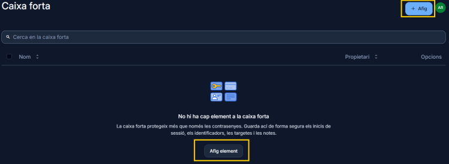

Al menu deplegable trim l'opcio de "Inici de sessió"

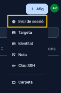

Aqui hem d'omplir les nostres dades corresponents i guardem.

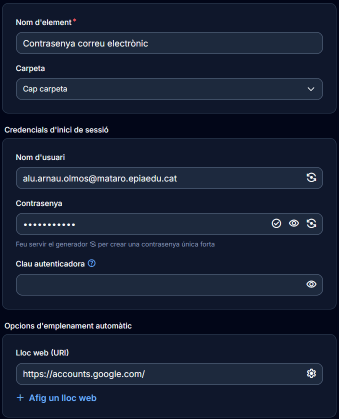

Podem tornar a a la pagina prinicpal i trobarem que s'a guardat la nostre clau d'acces al correu electronic.
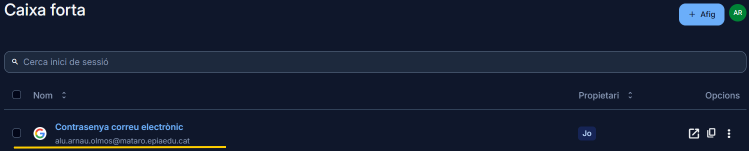

El que ens permet aquesta accio que hem realitzat es que no ens hem d'enrecordar de la contrasenya dels correus que tinguem, nomes creem el inici de sessió al bitwarden un cop i ja podrem accedir al correu sense tenir que enrecordarnso de la contrasenya.

### 3.2.Com fer servir l’extensió del navegador per emplenar automàticament les dades

Bitwarden tamb existeix com a extensio del navegadro, que serveix per emplenar automaticament tot aixo que hem fet fins ara pero mes senzill, ja que no necessita instalar res en local, i per tant podem fer-ho servir desde cualsevol dispositiu on nomes aurem de posar la clau mestre un cop i ja.

El funcionament es que nosltres inicem sessio a cualsevol servei web i amb l'extensio activada, bitwarden ens dira si volem guardar l'acces, acceptem i llavors el proxim cop que tornem aquesta pagina bitwarden ens oferira autocompletar els camps.

## 4.Gestió de Còpies de Seguretat (Backup)

### 4.1.Com fer una còpia de seguretat de l'arxiu de contrasenyes
A Bitwarden tenim l'opcio de exportat/fer una copia de seguretat, de la nostre caixa forta, que es on guardem tota la nostre informacio.

Per fer-ho, anem al menu desplegable de l'esquerra i seleccionem "Exporta".

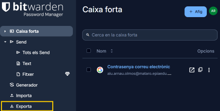

Escollim en quin tipus o volem.

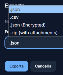

I exportem. Al intentar-ho ens demanara la clau de la caixa forta per temes de seguretat.

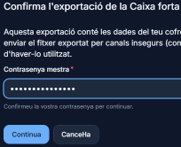

I ja podrem guardar-ho on volguem.El nom de l'arxiu per defecte, inclou la data en que sa relitzar l'exportacio.
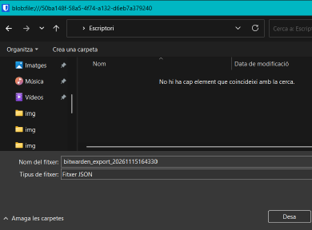

### 4.2.Recomanació de la millor pràctica per emmagatzemar aquesta còpia de seguretat

Un cop exportat l'arxiu de la còpia de seguretat, la millor pràctica és no deixar-lo mai al disc dur del teu ordinador. Per emmagatzemar-lo de forma segura, es recomana una d'aquestes dues opcions:

Clau USB xifrada: Guarda l'arxiu en un llapis de memòria (USB) extern. Per a una seguretat òptima, xifra aquest dispositiu amb eines com BitLocker o VeraCrypt i desa'l físicament en un lloc segur (com un calaix amb clau), completament aïllat d'internet.

Emmagatzematge xifrat al núvol: Si prefereixes tenir la còpia accessible des de qualsevol lloc en cas d'emergència, puja l'arxiu a un servei al núvol que ofereixi xifratge d'extrem a extrem (com Proton Drive o Tresorit). Com que l'exportació de Bitwarden ja està protegida per contrasenya, desar-la en un núvol segur garanteix disponibilitat sense comprometre'n la privacitat."