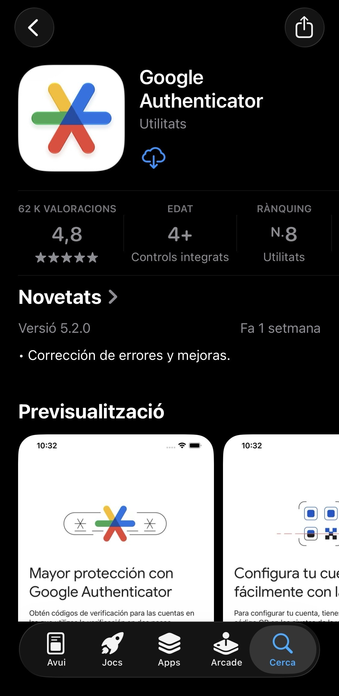
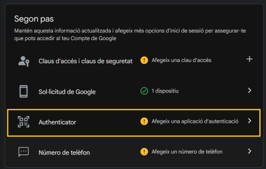
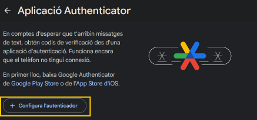
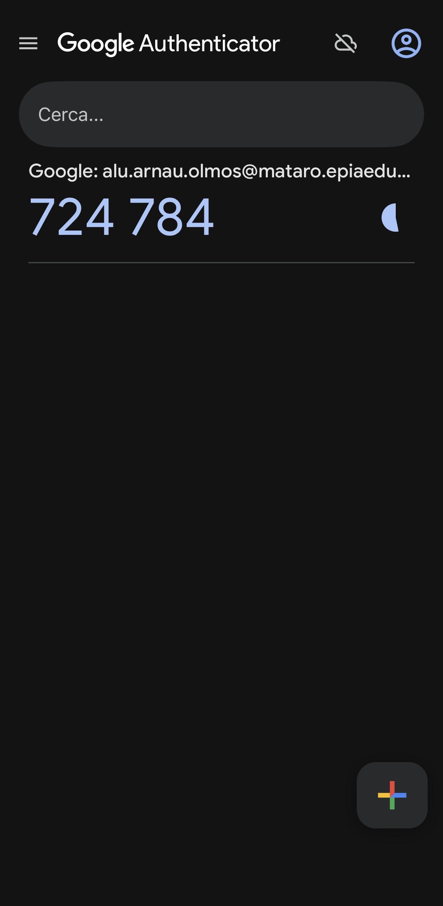
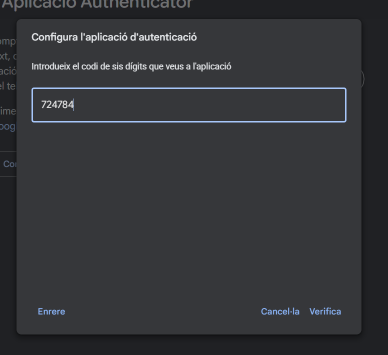
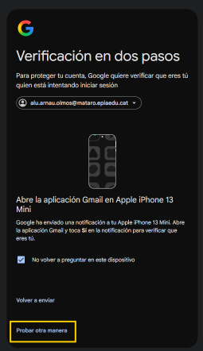
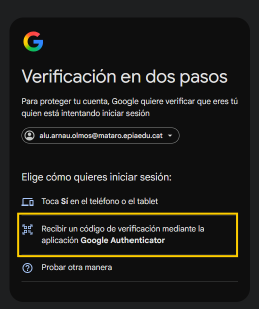
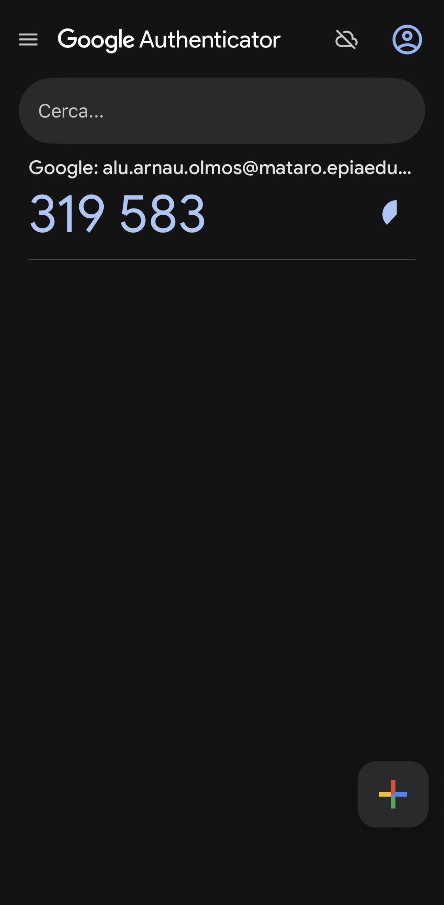

# Guia Insatalacio Google Authenticator

## 1.Instalar l'app
Anem al nostre gestor d'aplicacions mobil, en aquest cas la App Store, instalem el Google Authenticator.

## 2.Configuració del nostre compte a la pestanya de seguretat i a Inici de sessió a Google.
Per a configurar que per iniciar sessió en qualsevol dispositiu, ens demani el google authenticator, primer hem dactivar l'authenticacio en dos pasos.

Per fer aixo ens hem de dirigir a la configuracio del compte a l'aparatat de `Seguretat i Inici de sessió`

Cliquem on diu Authenticator

I despres a Configurar l'autenticador

Ens apareixera un codi QR, que hem descanegar amb el dipositiu on hem instalt l'aplicio

Al escanejar el codi QR ens apreixera un codi de 6 digits.

Aquest codi de 6 digits l'hem de posar al recuadre que ens apareix al dispositiu que volem iniciar sessió.

Un cop fet aixo ja tindrem la verificaio en dos pasos activada atraves de Google Authenticator.
## 3.Comprovacions
Si provem d'inicar sessió en un dispositiu nou, en sortira aquesta finsetra, sino ens surt directament per fer-ho per Google Authenticator, hem de marcar l'opcio de "Probar otra manera"

Aqui marquem l'opcio de Google Authenticator

Ens demanara un codi, que ens arribar al dispositiu que tenim vinculat, el posem i ja hem iniciat sessió.

Despres d'aixo ja entrem al nostre compte, no posso captura peru ho he fete desde el mode incognit.