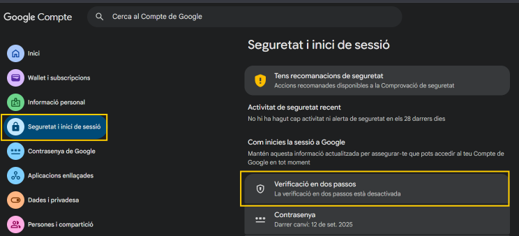
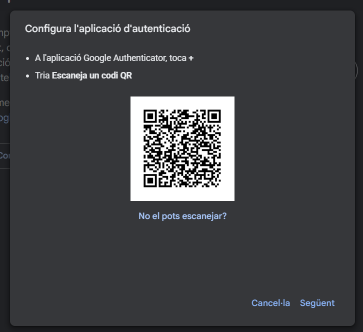
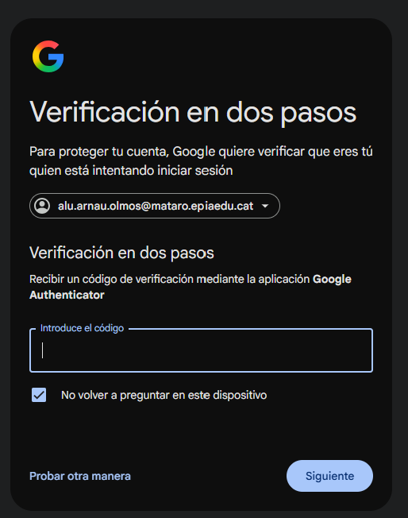

# Guia Insatalacio Google Authenticator

## 1.Instalar l'app
Anem al nostre gestor d'aplicacions mobil, en aquest cas la App Store, instalem el Google Authenticator.

## 2.Configuració del nostre compte a la pestanya de seguretat i a Inici de sessió a Google.

## 3.Comprovacions

Despres d'aixo ja entrem al nostre compte, no posso captura peru ho he fete desde el mode incognit.